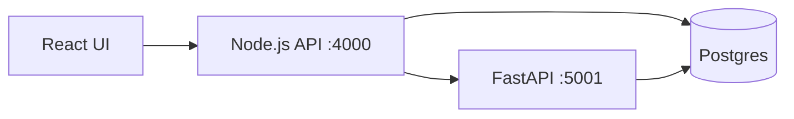

# Barangay Luinab — Intelligent Profiling & Social Assistance Suggestion System

Barangay profiling, socio-economic classification (Random Forest), and social
assistance suggestion system for Barangay Luinab.

## Architecture

| Part     | Tech                                     | Port  | Notes                              |
|----------|------------------------------------------|-------|-------------------------------------|
| frontend | React + Vite + Tailwind CSS              | 5173  | Admin / Captain / Staff dashboards |
| backend  | Node.js + Express + JWT                  | 4000  | REST API, service-role DB access   |
| ml       | Python + FastAPI + scikit-learn          | 5001  | Random Forest classify + suggest   |
| db       | PostgreSQL (PGlite in dev / Supabase)    | —     | Same SQL runs on both              |



## Quick start

1. Backend: `cd backend && npm install && npm run dev`
2. ML: `cd ml-service && pip install -r requirements.txt && python app/train.py && uvicorn app.main:app --reload --port 5001`
3. Frontend: `cd frontend && npm install && npm run dev`
4. Open http://localhost:5173

## Reports

Both **CSV** and **PDF** exports are available from the Reports page:

- CSV is generated server-side (`GET /reports/generate/:type`).
- PDF is generated client-side with `jspdf` + `jspdf-autotable`, using data from
  `GET /reports/data/:type`. Report types: `households`, `approved`,
  `distribution`, `analytics`.

Seed logins (created on backend start):

| Role    | Username | Password    |
|---------|----------|-------------|
| Admin   | admin    | admin123    |
| Captain | captain  | captain123  |
| Staff   | staff    | staff123    |

## Environment

Copy `backend/.env.example` → `backend/.env`. Default dev DB is PGlite (in-memory,
seeded automatically). Set `DATABASE_URL` to use a real Postgres/Supabase
instance — the same SQL schema is applied from `supabase/migrations/`.

ML service URL is configured via `ML_SERVICE_URL` (default `http://localhost:5001`).

## Repo layout

```
backend/           Express API (routes, middleware, db)
frontend/          React app
ml-service/        FastAPI + Random Forest training/prediction
supabase/migrations/  Canonical Postgres schema + seed
docs/              DFD, ERD, questionnaires
```
